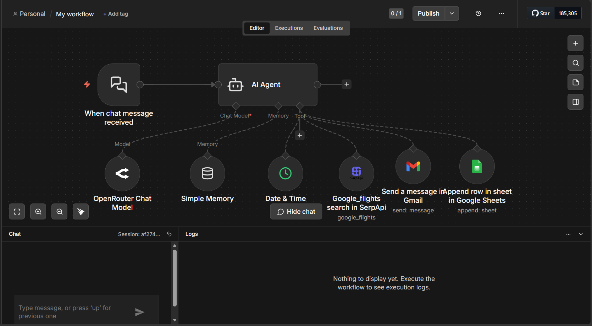

# ✈️ AI Travel Planner (n8n)

## 📌 Description
AI-powered workflow that automates travel planning using natural language.

## 🖼️ Workflow Preview


## ⚙️ Features
- Chat-based trip requests
- Flight search integration (Google Flights via SerpApi)
- Automatic logging in Google Sheets
- Email notifications with trip details

## 🛠️ Tech Stack
- n8n
- OpenRouter (LLM)
- SerpApi (Google Flights)
- Google Sheets API
- Gmail API

## 💡 Use Case
User sends a message like:
"Plan me a trip from Tunis to Paris next week"

→ The system:
1. Searches for flights
2. Stores results in Google Sheets
3. Sends an email with details

## 🚀 Setup
1. Import `ai-travel-planner-workflow.json` into n8n (**Workflows → Import from file**).
2. Create and connect your own credentials:
   - OpenRouter API
   - SerpApi
   - Gmail OAuth2
   - Google Sheets OAuth2
3. Create a Google Sheet with these columns in the first row:
   `Flight code`, `Departure Airport`, `Departure Time`, `Arrival Airport`, `Arrival Time`, `Company`
4. In the Google Sheets node, select your sheet (replace `YOUR_SHEET_ID`).
5. In the Gmail node, replace `your-email@example.com` with your own email.
6. Open the chat and send a trip request.

## 📁 Project Structure
```
ai-travel-planner-n8n/
├── README.md
├── ai-travel-planner-workflow.json
└── images/
    └── workflow.png
```
